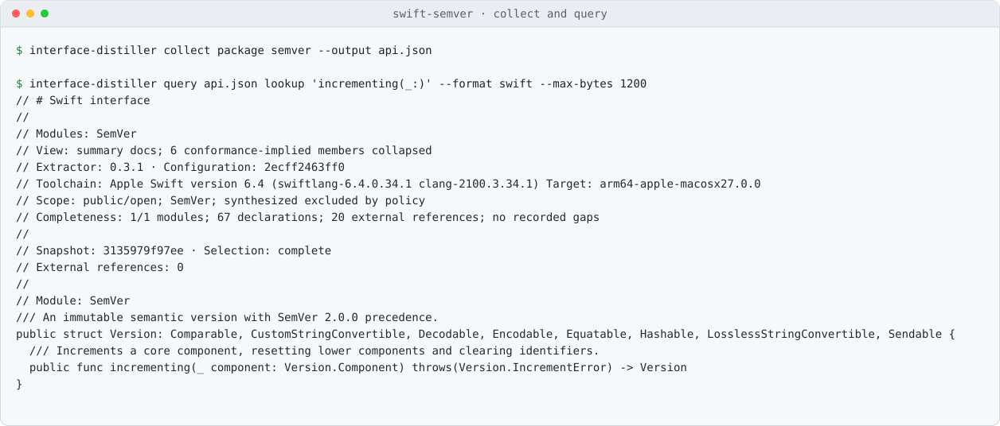

<div align="center">

<p align="center">
  <a href="https://github.com/swift-library/swift-interface-distiller"></a>
</p>

<h1 align="center">swift-interface-distiller</h1>

<p align="center">
  Distill a Swift package to its public API: a compact interface to read, evidence to query and diff.
</p>

<p align="center">
  <a href="https://github.com/swift-library/swift-interface-distiller/actions/workflows/ci.yml"></a>
  
  
  <a href="LICENSE.txt"></a>
</p>

<p align="center">
  <a href="#overview">Overview</a> ·
  <a href="#quick-look">Quick look</a> ·
  <a href="#install">Install</a> ·
  <a href="#usage">Usage</a> ·
  <a href="#requirements">Requirements</a> ·
  <a href="#documentation">Documentation</a> ·
  <a href="#contributing">Contributing</a> ·
  <a href="#license">License</a>
</p>

</div>

## Overview

Read public declarations reported by the compiler without walking a package’s implementation. Markdown serves people and JSON serves machines, with explicit gaps and deterministic normalization for identical observations. See the [interface guide](Documentation/ReadingInterfaces.md) for measured sizes, budgets, collection scope, and limits.

## Quick look

Collect swift-semver, then query its incrementing declaration within a byte budget:

<p align="center">
  <picture>
    <source media="(prefers-color-scheme: dark)" srcset="Documentation/Assets/Demo-dark.svg">
    <source media="(prefers-color-scheme: light)" srcset="Documentation/Assets/Demo-light.svg">
    
  </picture>
</p>

## Install

Add the package and the `InterfaceDistiller` product to `Package.swift`:

```swift
dependencies: [
  .package(
    url: "https://github.com/swift-library/swift-interface-distiller.git",
    .upToNextMinor(from: "0.3.1")
  ),
],
targets: [
  .target(
    name: "YourTarget",
    dependencies: [
      .product(name: "InterfaceDistiller", package: "swift-interface-distiller"),
    ]
  ),
]
```

Install the command-line tool with Homebrew:

```sh
brew install swift-library/tap/swift-interface-distiller
```

On macOS, the formula requires macOS 15 or later and Xcode 26 or later with
Swift 6.3 or later selected. See the [tap requirements](https://github.com/swift-library/homebrew-tap/blob/master/Documentation/Tools.md).

The [versioned consumer](Examples/Consumer) is a complete downstream example.
Build the executable from a checkout with
`swift build --build-system native -c release`; it is written to
`.build/release/interface-distiller`.

> [!NOTE]
> swift-interface-distiller is pre-1.0. Minor releases may include source-breaking
> changes, so depend on it with `.upToNextMinor(from:)`.

## Usage

Choose the package, modules, configuration, and optional scope explicitly. Query or slice a snapshot as JSON, Swift, or Markdown, then compare it with a release snapshot; the [interface guide](Documentation/ReadingInterfaces.md) explains the workflow and [commands](Documentation/Commands.md) lists the complete grammar.

## Requirements

- Swift 6.3 or later; macOS deployment floor 12, or Linux.
- A matching compiler, SDK and target configuration for collection. Consuming
  existing evidence through the library does not run a compiler.
- Clang ExtractAPI for C and Objective-C headers.

CI selects Xcode 26.6 on macOS 26 and Swift 6.3 on Ubuntu 24.04. The
[capability matrix](Documentation/Capabilities.md) records tested combinations and
compiler/SDK limits. Run `Scripts/check` for package validation and
`Scripts/check-consumer` for a fresh versioned consumer after publication.
Temporary output belongs in `.build/`.

## Documentation

- [Reading public interfaces](Documentation/ReadingInterfaces.md): measured sizes, queries, budgets, and boundaries.

- [Usage guide](Documentation/Reference/Usage.md): examples, behavior, and limits.
- [InterfaceDistiller module](Sources/InterfaceDistiller/InterfaceDistiller.docc/InterfaceDistiller.md)
- [Evidence contracts](Documentation/Contracts.md) and [JSON schema](Documentation/Schema/Evidence.schema.json)
- [Commands](Documentation/Commands.md) and [capabilities](Documentation/Capabilities.md)
- [Extension proposals](Documentation/Proposals/Extensions.md)
- [Development sources](Documentation/DevelopmentSources.md) and [changelog](CHANGELOG.md)
- [Versioning and release policy](https://github.com/swift-library/.github/blob/master/VERSIONING.md)

## Contributing

Read the shared [contributing guide](https://github.com/swift-library/.github/blob/master/CONTRIBUTING.md)
and run `Scripts/check` before submitting a pull request. Report vulnerabilities
through the private route in the [security policy](https://github.com/swift-library/.github/blob/master/SECURITY.md).
This project follows the [code of conduct](https://github.com/swift-library/.github/blob/master/CODE_OF_CONDUCT.md).

## License

swift-interface-distiller is available under the Apache License 2.0 with the Swift
Runtime Library Exception. See [LICENSE.txt](LICENSE.txt) and [NOTICE](NOTICE).
