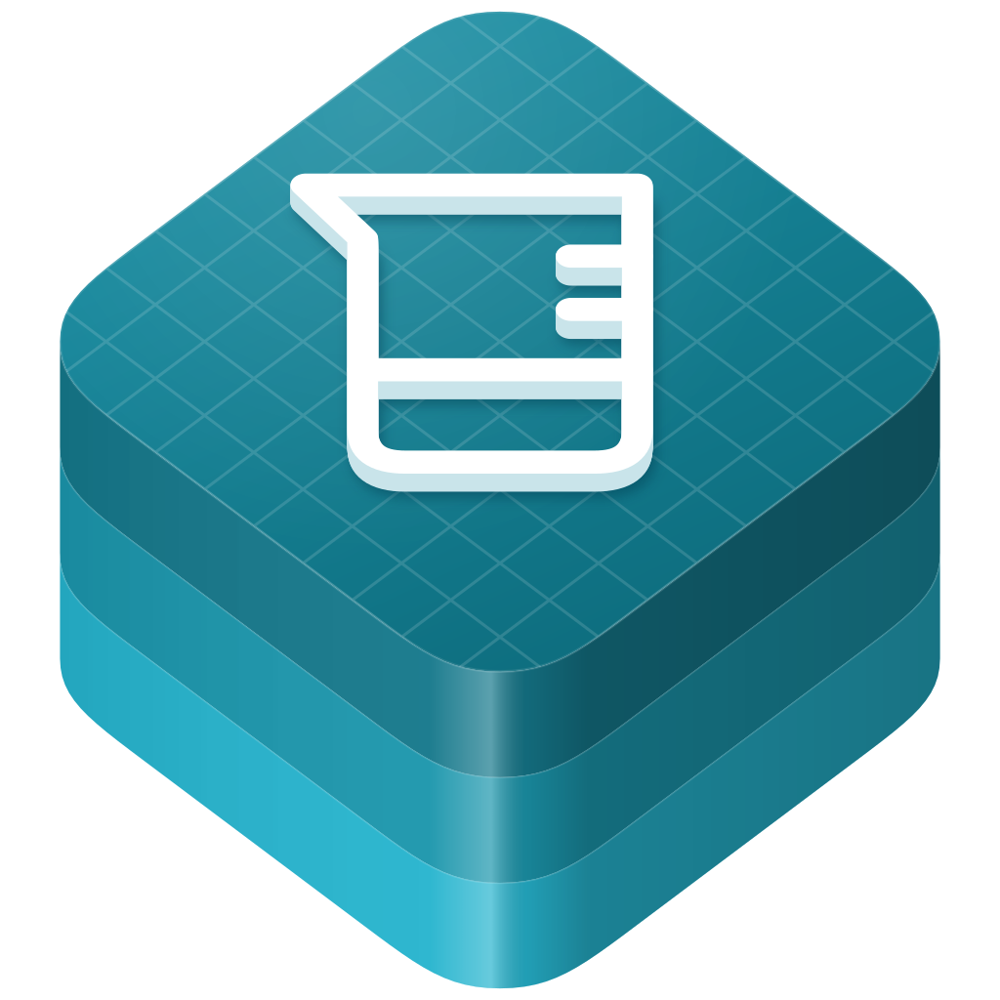

<p align="center">
  
</p>

<h1 align="center">swift-interface-distiller</h1>

<p align="center">
  Collect, query, and compare public-interface evidence from compiler reports.
</p>

<p align="center">
  <a href="https://github.com/swift-library/swift-interface-distiller/actions/workflows/ci.yml"></a>
  
  
  <a href="LICENSE.txt"></a>
</p>

[Overview](#overview) · [Install](#install) · [Quick start](#quick-start) ·
[Usage](#usage) · [Requirements](#requirements) · [Documentation](#documentation) ·
[Contributing](#contributing) · [License](#license)

> [!NOTE]
> swift-interface-distiller is pre-1.0. Minor releases may include source-breaking
> changes, so depend on it with `.upToNextMinor(from:)`.

## Overview

swift-interface-distiller produces public-interface evidence for local Swift
packages, compiler symbol graphs, importable modules, and C or Objective-C
headers. Each snapshot records its build configuration, collection scope,
provenance and gaps. The `InterfaceDistiller` library and `interface-distiller`
executable share the same model.

- Canonical JSON evidence and Markdown with stable links and optional byte budgets.
- Lookup, members, observed conformers, initializer and return-type candidates,
  and bounded dependency slices tied to one snapshot.
- Field-level comparison separating interface, documentation, availability and
  provenance changes, with compiler API diagnostics as a separate artifact.
- Baseline write/check commands, documentation coverage, and content-keyed caches.

Evidence describes compiler observations. Release policy and version decisions
belong to the consuming workflow. Read the [contracts](Documentation/Contracts.md)
for identity, completeness, determinism and failure behavior.

## Install

Add the package and the `InterfaceDistiller` product to `Package.swift`:

```swift
dependencies: [
  .package(
    url: "https://github.com/swift-library/swift-interface-distiller.git",
    .upToNextMinor(from: "0.1.1")
  ),
],
targets: [
  .target(
    name: "YourTarget",
    dependencies: [
      .product(name: "InterfaceDistiller", package: "swift-interface-distiller"),
    ]
  ),
]
```

The [versioned consumer](Examples/Consumer) is a complete downstream example.
Build the executable from a checkout with
`swift build --build-system native -c release`; it is written to
`.build/release/interface-distiller`.

## Quick start

From this repository, collect its fixture package, query a declaration, then
render the snapshot:

```sh
.build/release/interface-distiller collect package \
  Tests/InterfaceDistillerTests/Fixtures/Example --output .build/fixture.json
.build/release/interface-distiller query .build/fixture.json lookup Item
.build/release/interface-distiller render .build/fixture.json --output-dir .build/markdown
```

The query includes this compiler identity for `Item`:

```json
{
  "language": "swift",
  "module": "EvidenceExample",
  "preciseIdentifier": "s:15EvidenceExample4ItemV"
}
```

This excerpt selects three fields from the returned symbol. The complete result
also carries the snapshot identity, configuration, declaration fields and
provenance. Markdown is written as `part-000001.md` and subsequent parts when a
byte budget splits the output.

## Usage

Replace the fixture path with a local package path to collect its library
products. Select modules with `--module`, add resolved dependency modules with
`--dependency-module`, and narrow declarations with `--include` and `--exclude`;
exclusion takes precedence. SPI and source locations are opt-in.

```sh
interface-distiller query .build/api.json members MyType
interface-distiller query .build/api.json slice MyType --max-symbols 100
interface-distiller coverage .build/api.json
interface-distiller baseline write .build/api.json .build/baseline.json
interface-distiller baseline check .build/api.json .build/baseline.json
```

Use the installed executable, or substitute `.build/release/interface-distiller`
when running from a checkout. Command data goes to stdout, errors are JSON on
stderr, and failed writes preserve existing baselines. A bounded slice reports
omitted references explicitly. [Commands](Documentation/Commands.md) covers
configuration, graph normalization, binary modules, headers and API diagnostics.

## Requirements

- Swift 6.3 or later; macOS deployment floor 12, or Linux.
- A matching compiler, SDK and target configuration for collection. Consuming
  existing evidence through the library does not run a compiler.
- Clang ExtractAPI for C and Objective-C headers.

CI selects Xcode 26.6 on macOS 26 and Swift 6.3 on Ubuntu 24.04. The
[capability matrix](Documentation/Capabilities.md) records tested combinations and
compiler/SDK limits. Run `Scripts/check` for package validation and
`Scripts/check-consumer` for a fresh versioned consumer after publication.
Temporary output belongs in `.build/`.

## Documentation

- [InterfaceDistiller module](Sources/InterfaceDistiller/InterfaceDistiller.docc/InterfaceDistiller.md)
- [Evidence contracts](Documentation/Contracts.md) and [JSON schema](Documentation/Schema/Evidence.schema.json)
- [Commands](Documentation/Commands.md) and [capabilities](Documentation/Capabilities.md)
- [Extension proposals](Documentation/Proposals/Extensions.md)
- [Development sources](Documentation/DevelopmentSources.md) and [changelog](CHANGELOG.md)
- [Versioning and release policy](https://github.com/swift-library/.github/blob/master/VERSIONING.md)

## Contributing

Read the shared [contributing guide](https://github.com/swift-library/.github/blob/master/CONTRIBUTING.md)
and run `Scripts/check` before submitting a pull request. Report vulnerabilities
through the private route in the [security policy](https://github.com/swift-library/.github/blob/master/SECURITY.md).
This project follows the [code of conduct](https://github.com/swift-library/.github/blob/master/CODE_OF_CONDUCT.md).

## License

swift-interface-distiller is available under the Apache License 2.0 with the Swift
Runtime Library Exception. See [LICENSE.txt](LICENSE.txt) and [NOTICE](NOTICE).
